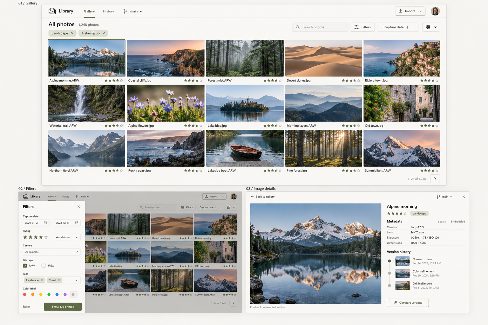

# Approved Frontend Visual Reference

**Feature**: [015 Gallery-First Frontend](../spec.md)

**Approval**: The project owner approved this generated mockup in the conversation requesting the feature.

## Reference Meaning

The image presents three states of one application, not three simultaneously displayed product panels. External `01 / Gallery`, `02 / Filters`, and `03 / Image details` captions are presentation labels and must not appear in the frontend.

The top establishes a photographic contact sheet; lower-left shows a temporary left filter drawer overlaying that gallery; lower-right shows contained image detail with metadata/history inspector. The image governs hierarchy/composition. The spec governs actual data, behavior, accessibility, privacy, and existing contracts. This is a built-in image-generation visual concept, not executable code.

## Visual Acceptance Criteria

Use deterministic non-private fixtures at 1440 × 960 and 1280 × 800, normal text scale, loaded thumbnails. Review screenshots beside this reference; illustrative text/photos need not match production pixel for pixel.

| Surface | Required result | Measurable criterion |
|---|---|---|
| Appearance | Warm ivory, charcoal, restrained olive, soft dividers. | Target canvas `#F7F6F2`, primary text near `#242621`, olive near `#596744`, dividers near `#DEDED7`. Final secondary/control colors meet accessibility contrast. No decorative gradients/saturated replacement palette. |
| Typography | Crisp sans-serif hierarchy and readable labels. | Essential labels/body at least 14 CSS pixels; titles 20–24 pixels; no marketing-size heading. |
| Header | Slim row with Library, Gallery/History, branch, Import, owner controls. | 48–64 pixels high; no permanent wide sidebar or diagnostic block above gallery. |
| Toolbar | Title/count, search, Filters, sort/density, active chips. | Header plus title/toolbar/chips occupy at most 200 vertical pixels in the reference fixture. |
| Contact sheet | Photography dominates with unobtrusive captions/ratings. | Loaded thumbnail rectangles occupy at least 65% of visible gallery content below toolbar with a full page and closed drawer. Normal density has at least four columns at 1280 pixels, five at 1440; gaps 4–12 pixels. Preserve proportions and readable captions. |
| Controls | Restrained borders/rounding; no heavy tile boxes. | Corners 6–10 pixels; shadows limited to overlays; selected/focus states distinct. |
| Drawer | Temporary left overlay with gallery visible right. | Desktop width 280–360 pixels; internal scrolling if needed; Apply/Reset reachable; gallery does not acquire a permanent filter column. |
| Detail | Large contained preview left; quiet inspector right. | Inspector 30–40% of desktop content width, preview fills remainder minus spacing. Short-metadata/three-version fixture shows Metadata and Version history headings plus at least two history entries in the first viewport. Longer content may scroll. No stretch/destructive preview crop. |
| Metadata | Aligned values with restrained source labels. | Camera/lens/exposure/dimensions visible when present; long values wrap or expand accessibly; missing/cleared/source labels legible. |
| History | Restrained timeline/list, current marker, message/date, compare action. | Text as well as color for state; historical thumbnails only if available; branch/merge/hidden disclosures when applicable; full history reachable. |
| Narrow view | Controls preserved with sequential reading order. | At 390 × 844 detail stacks preview before inspector; drawer may fill width; no horizontal page scrolling. Functional reflow at 320 CSS pixels. |

Visual review assesses hierarchy, proportions, palette, imagery, density, controls, and the three layouts. Backend correctness/accessibility are separate mandatory checks. Sample counts (`1,248`, `128`), photos, camera values, filenames, dates, and avatar are never hard-coded production requirements.

## Generation Direction

The approved image was generated as a high-fidelity straight-on concept for a private darktable-compatible library: large primary gallery and two supporting states, warm ivory/charcoal/olive, sample landscape/travel photography, temporary left metadata filters, and selected image with metadata/exact-version history. It omits RAW-editing sliders and heavy dashboard decoration.
